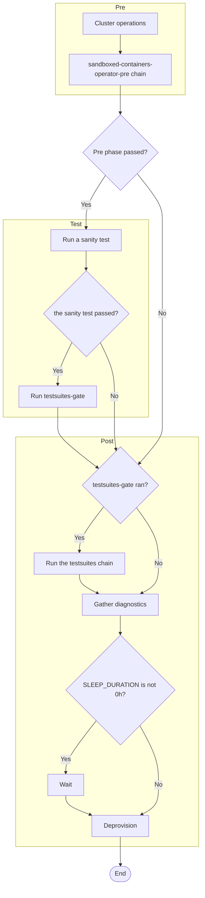

# Intended OSC CI Workflow Structure

<!-- BEGIN GENERATED WORKFLOW GRAPH -->



<!-- END GENERATED WORKFLOW GRAPH -->

For changes to reusable steps, chains, or workflows, see the
[OSC step-registry contribution guide](../../../step-registry/sandboxed-containers-operator/CONTRIBUTING.md).

## Finding steps

OCP has probably already created a step that you need.

 Browse [steps.ci.openshift.org](https://steps.ci.openshift.org/).  Using Ctrl+F, the built-in search is iffy.   Ex: search for `sandboxed` to find all our stuff.  The 1st page doesn't have all possible steps.  Many steps are in different steps, workflows or chains.

Step names are tied to filenames and directories.  I recommend pointing your AI agent  at https://gitlab.cee.redhat.com/osc/osc-LLM-wiki to import all the context needed

The`sandboxed-containers-operator-aws-region-override`step was an anomoly that has been adopted by others in prow

## Outline for the diagram
### Pre phase

1. **Cluster operations**
   - First part of the **pre** phase
   - Pick a provider/OCP version and install a cluster
   - Configure the cluster for general use
   - See the step graph at the bottom of the [sandboxed-containers-operator-e2e-aws workflow](https://steps.ci.openshift.org/workflow/sandboxed-containers-operator-e2e-aws).

2. **sandboxed-containers-operator-pre chain**
  - This is the last part of the **pre** phase.
    - After the custer is installed, this is getting ready to test
    - Does not depend on the provider
     - Anything to change a cluster after installation before OSC can be used
  - Configure for operator & test
    - `peerpods-param-cm` step for operator
    - `env-cm` step for test parameters and mirror
    - Operator installs
      - `install-osc-operator` and `install-trustee-operator` steps use  [Helm charts ](https://github.com/confidential-devhub/charts)
        - creates catsrc
        - creates `peer-pods-cm`
        - `install-osc-operator` and `install-trustee-operator` steps include stuff that should be in the helm charts
    - `update-kata-rpm` step
    - `record-metadata` step - records items in the log for reporting with  `prowjob-analyzer`
  - See the step graph for the [OSC pre chain](https://steps.ci.openshift.org/chain/sandboxed-containers-operator-pre)

### Test phase
3. **Run a sanity test.**
   - Run one test if and only if the **pre** phase did not have errors
4. **Run `testsuites-gate`.**
   - Run only if the sanity test passed.
   - Enable testsuites in the **post** phase.

### Post phase
5. **Run the testsuites chain.**
   - In **post** phase to ensure they all run
   - Run only if `testsuites-gate` ran.
   -  [sandboxed-containers-operator-e2e-aws workflow](https://steps.ci.openshift.org/workflow/sandboxed-containers-operator-e2e-aws). shows  empty boxes for this chain of steps.

6. **Gather diagnostics.**
   - Run OSC must-gather.

7. **Wait.**
   - Linger for interactive use.
   - Run only if `SLEEP_DURATION` is not `0h`.
   - might be an empty box on the chart
   - `sandboxed-containers-operator-post-wait` step
     - previously used OCP's `cucushift-install-wait` step


8. **Deprovision.** Destroy the cluster.
   - `sandboxed-containers-operator-post` step
     - removes items from cluster that the OCP deprovision steps do not to
   - OCP deprovisions

## Regenerating the step graph

This graph shows the intended workflow, not the live CI configuration. The phase
headings and bold titles of the numbered steps above define the graph's groups,
labels, and order. A `Run only if …` bullet adds a decision that skips just that
step when false. If the pre phase fails, the test phase is skipped and the post
phase still runs.

After editing the steps, regenerate the graph from the repository root:

```sh
python3 ci-operator/config/openshift/sandboxed-containers-operator/generate-step-graph.py
```
