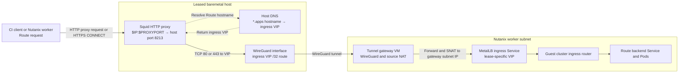

# Nutanix Agent HostedCluster conformance

This workflow runs a HostedCluster on the baremetal management cluster and boots
its guest workers as Nutanix VMs. A separate Nutanix VM acts as the ingress
tunnel gateway. The `nutanix-quota-slice` lease selects the run's capacity and
ingress VIP.

## Route request path

The HostedCluster and Nutanix InfraEnv configure `httpProxy` and `httpsProxy`
to use `http://$IP:$PROXYPORT`, the client-facing Squid endpoint on the leased
baremetal host. Squid listens on host port 8213; OFCIR may map that to a
different `PROXYPORT`. Clients using that proxy send Route requests to Squid
first. For an HTTPS Route, the client sends an HTTP `CONNECT`
request; Squid forwards the encrypted connection after resolving the Route
hostname. Allowed HTTP Route requests follow the same network path on port 80.



The baremetal host's DNS mapping resolves `*.apps.<cluster>.<base-domain>` to
the ingress VIP. Its `/32` route sends traffic for that VIP over WireGuard.
The gateway forwards it onto the Nutanix worker subnet and applies source NAT
so replies return through the gateway and tunnel. MetalLB advertises the VIP
for the guest ingress Service; the ingress router then selects the Route
backend. Squid does not terminate HTTPS; TLS termination follows the Route's
configuration.

Worker DNS is a separate path. Each worker's NMStateConfig points DNS at the
gateway's subnet IP. The gateway forwards port 53 over WireGuard to a dedicated
dnsmasq on the baremetal host. That resolver returns the management cluster IP
for `api` and `api-int`, and the Nutanix ingress VIP for `*.apps`. A proxied
Route request uses Squid's DNS lookup on the baremetal host; it does not depend
on the worker resolving the Route hostname first.

## Accessing Prism Central UI

1. Ask Jim McCann in `#triage-ocp-nutanix-ci` to invite you to the Red Hat network via Twingate.
2. [Install Twingate](https://www.twingate.com/docs/linux), then set it up and start it:

   ```bash
   sudo twingate setup
   twingate start
   # When finished:
   twingate stop
   ```

3. Open <https://prismcentral.lts2-cluster.in.nutanix-ci.devcluster.openshift.com:9440>.

Prism credentials are available in `$SHARED_DIR/nutanix_context.sh` in a CI Pod
using the `equinix-ocp-hcp-nutanix` cluster profile.

## Connecting from a CI Pod to a Nutanix VM

Run these commands in the CI Pod with the workflow's `SHARED_DIR`. The context
file provides the Prism API URL and credentials. Keep shell tracing disabled
while using them.

```bash
source "$SHARED_DIR/packet-conf.sh"
source "$SHARED_DIR/nutanix_context.sh"
uuid=$(head -n 1 "$SHARED_DIR/vm_uuids.txt")
vm_ip=$(curl -fsSk -u "$NUTANIX_USERNAME:$NUTANIX_PASSWORD" \
  "$NUTANIX_PC_URL/api/nutanix/v3/vms/$uuid" |
  jq -er 'first(.status.resources.nic_list[]?.ip_endpoint_list[]?.ip)')
ssh "${SSHOPTS[@]}" -tt -o ExitOnForwardFailure=yes \
  -R 127.0.0.1:22222:${vm_ip}:22 "root@$IP" \
  'ssh -p 22222 -i /root/.ssh/id_rsa core@127.0.0.1'
```

This reverse SSH forward is for diagnostics and is separate from the WireGuard
Route tunnel in the diagram. The CI Pod must be able to reach the VM's IP on
port 22.

If you already know the VM IP, for example from Prism Central, set `vm_ip`
directly and use the same SSH forwarding path:

```bash
source "$SHARED_DIR/packet-conf.sh"
vm_ip=10.0.130.67 # Replace with the VM's current IP.
ssh "${SSHOPTS[@]}" -tt -o ExitOnForwardFailure=yes \
  -R 127.0.0.1:22222:${vm_ip}:22 "root@$IP" \
  'ssh -p 22222 -i /root/.ssh/id_rsa core@127.0.0.1'
```

On the Nutanix worker, inspect the Agent service with:

```bash
sudo journalctl -u agent.service -f
```

## Connecting from a CI Pod to the baremetal host

```bash
source "$SHARED_DIR/packet-conf.sh"
ssh "${SSHOPTS[@]}" "root@$IP"
```

## Accessing Prismcentral UI using OpenVPN

1) Get openvpn.conf file from a CI pod that uses the equinix-ocp-hcp-nutanix cluster profile
2) Start VPN

```bash
sudo modprobe tun
sudo openvpn --config /path/to/openvpn.conf
```

3) Access https://prismcentral.lts2-cluster.in.nutanix-ci.devcluster.openshift.com:9440
