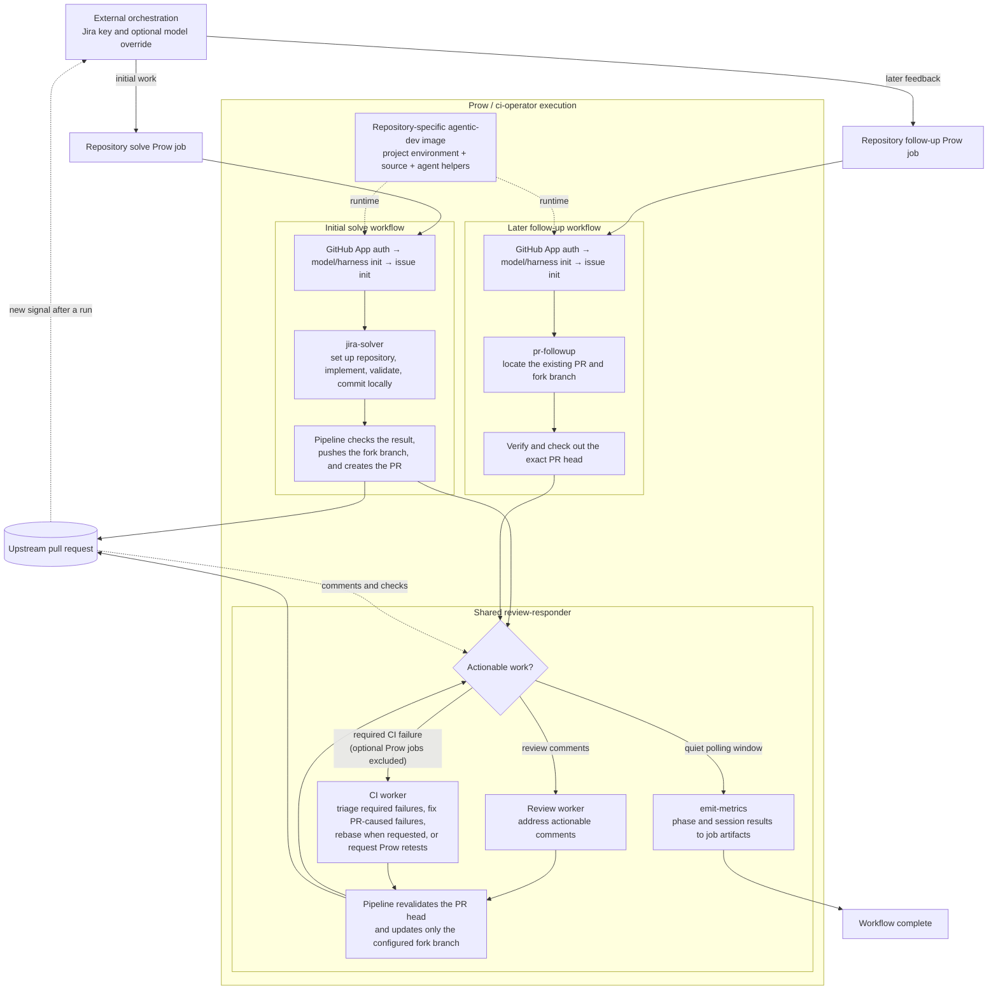

# TRT Agentic Solve Architecture

This directory defines reusable CI-operator workflows that turn a Jira issue
into a pull request and continue working on that pull request when review or
required-CI feedback arrives. Repository-specific CI configurations supply the
target repository, fork, development environment, setup command, and allowed
tools; the step registry supplies the common solve and follow-up behavior.

The workflows run in Prow. Request intake, selection of a repository job, and
detection of feedback after a workflow has finished are external orchestration
concerns and are intentionally outside this document.

## System overview

Both production workflows converge on the same review responder. The initial
workflow creates a PR and watches its first review/CI window. A later follow-up
workflow reopens that loop for an existing PR; it does not create another PR.
The diagram therefore has one workflow terminal and does not conflate it with
any state an external orchestrator may persist.

## Component responsibilities

- **Repository job configuration** builds `agentic-dev` from the repository's
  development image, checked-out source, nested-container support, and shared
  agent helpers. It also supplies `UPSTREAM_REPO`, `FORK_REPO`, `SETUP_SCRIPT`,
  and the tool allowlist. The TRT configurations currently cover
  [sippy][sippy-config], [origin][origin-config], and
  [ship-status-dash][ship-status-config].
- **Shared initialization** obtains short-lived GitHub App installation tokens,
  prepares the selected model harness, fetches the Jira issue, and passes data
  between steps through `SHARED_DIR`. The auth helper can refresh tokens before
  later writes in a long-running job.
- **`jira-solver`** runs repository setup and asks the selected agent to solve
  the issue. The agent works on a feature branch and commits locally. The
  surrounding script verifies that a committed change exists, pushes only to
  the configured fork, and opens the upstream PR.
- **`pr-followup`** finds the PR associated with the issue and prepares its fork
  branch. It is the entry point for feedback that arrives after an earlier
  workflow has ended.
- **`review-responder`** uses a read-only gate to separate actionable review
  comments from required-CI work. Dedicated workers address comments or triage
  CI; the pipeline, rather than the worker, owns branch publication. Rebase
  updates use a lease, and failures classified as flaky or infrastructure can
  be sent back to Prow for a retest.
- **`emit-metrics`** converts solve and review metadata into job artifacts. The
  separate solver and review-responder evaluation workflows exercise known
  cases without changing the production flow.

## Work lifecycle

### Initial work

The repository jobs are defined as yearly periodics so they are available for
on-demand execution rather than a frequent schedule. Their Jira-key and model
inputs accept Gangway environment overrides.

1. `github-app-auth`, `init-model`, and `init` prepare authentication, select
   the agent harness, and fetch issue context.
2. `jira-solver` runs the target repository's setup, combines the common solve
   process with repository guidance, and invokes the agent. No separate
   planning workflow is defined in this registry.
3. The agent leaves a local commit. Pipeline code validates the branch and
   worktree, pushes the configured fork branch, and creates the upstream PR.
4. `review-responder` watches the new PR for an initial window, processes
   actionable comments and required-CI failures, and publishes guarded updates.
5. `emit-metrics` records the solve and review phases when the workflow exits.

### Later feedback

External orchestration may start the follow-up job when a new actionable review
comment or a newly failing required check appears after the initial job. The
required-CI signal excludes optional Prow jobs.

The follow-up workflow repeats authentication and initialization, uses
`pr-followup` to locate the existing PR, then runs the same review responder.
Before a worker runs, the responder verifies the PR head repository, branch,
and SHA and checks out that exact commit. After a worker finishes, the pipeline
revalidates those boundaries before updating the configured fork ref. A
history-rewriting rebase is published only with a force-with-lease tied to the
previously observed head.

## Execution and authentication boundaries

- Prow supplies credentials as mounted inputs. The auth step exchanges the
  GitHub App credential for installation tokens and shares only the files that
  downstream steps need.
- The target repository controls its development environment and setup script;
  the common workflow controls issue ingestion, agent invocation, publication,
  and telemetry.
- Solve workers cannot push or create PRs. Review/CI workers may interact with
  the existing PR as required by their task, but pipeline code performs git
  pushes after verifying the destination and current PR head.
- Normal branch writes go only to the configured fork. The upstream repository
  receives the pull request, review replies, PR-description maintenance, and
  Prow retest requests—not direct branch pushes from the workflow.
- `init-model` provides one model-selection boundary for solve, review, and
  evaluation. GPT-named models use the Codex harness; other configured models
  use Claude Code. A Gangway override can select a model for one job without
  changing the workflow definition.

## Evaluation

The [solver evaluation workflow][solver-eval] runs known historical cases and
judges the resulting changes. The [review-responder evaluation
workflow][review-eval] seeds a controlled PR with review feedback, runs a
single response pass, judges the result, and cleans up. Both reuse shared model
initialization while keeping evaluation setup and cleanup outside production
jobs.

## Source navigation

- [TRT step-registry directory][registry]
- [Initial solve workflow][solve-workflow]
- [Follow-up workflow][followup-workflow]
- [Review responder implementation][review-responder]
- [Shared model and telemetry initialization][init-model]
- [Metrics emission][emit-metrics]
- Public CI job configurations for [sippy][sippy-config],
  [origin][origin-config], and [ship-status-dash][ship-status-config]

[registry]: ./
[solve-workflow]: jira-solver/openshift-agentic-trt-jira-solver-workflow.yaml
[followup-workflow]: pr-followup/openshift-agentic-trt-pr-followup-workflow.yaml
[review-responder]: review-responder/openshift-agentic-trt-review-responder-commands.sh
[init-model]: init-model/openshift-agentic-trt-init-model-ref.yaml
[emit-metrics]: emit-metrics/openshift-agentic-trt-emit-metrics-ref.yaml
[solver-eval]: eval/openshift-agentic-trt-eval-workflow.yaml
[review-eval]: review-responder-eval/openshift-agentic-trt-review-responder-eval-workflow.yaml
[sippy-config]: ../../../../config/openshift/sippy/openshift-sippy-main__agentic.yaml
[origin-config]: ../../../../config/openshift/origin/openshift-origin-main__agentic.yaml
[ship-status-config]: ../../../../config/openshift-eng/ship-status-dash/openshift-eng-ship-status-dash-main__agentic.yaml
