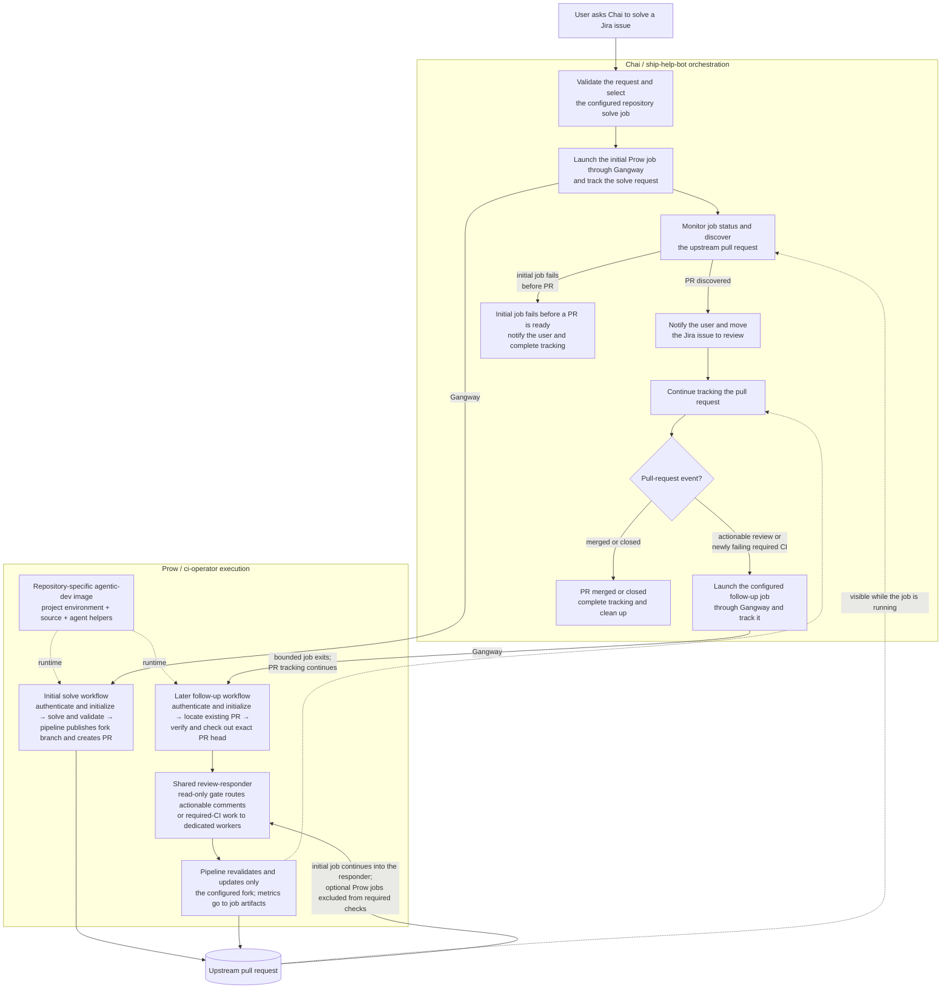

# TRT Agentic Solve Architecture

The agentic solve workflow has two cooperating layers. Chai (ship-help-bot)
orchestrates a solve from the user's request through pull-request completion.
Prow and ci-operator run the repository-specific work that creates or updates
the pull request. Keeping those responsibilities separate lets Chai manage the
long-lived conversation and PR lifecycle while each CI job remains bounded.

## System overview

The diagram shows one end-to-end lifecycle and both terminal outcomes for
Chai's tracking: an initial job can fail before producing a PR, or tracking can
end when an existing PR is merged or closed. The initial and follow-up Prow
workflows both converge on the same review responder, but finishing a bounded
CI job does not finish Chai's long-lived PR tracking.

## Component responsibilities

### Chai orchestration

- **Request tools** accept the solve request, validate the Jira issue, and use
  repository configuration to select the solve job, follow-up job, and fork.
- **Solve tracking and monitoring** record the active request, monitor the Prow
  job, discover its pull request, and continue tracking that PR after the
  initial job exits.
- **GitHub and Jira integration** inspect PR state and feedback, move the Jira
  issue to review when the PR is ready, and notify the user when work is ready
  for review or when an initial job fails.
- **Follow-up orchestration** starts another bounded Prow job when a new
  actionable review comment or newly failing required check needs attention.
  Optional Prow jobs are not treated as required-CI signals. When the PR merges
  or closes, Chai completes tracking and cleans up the active request. If the
  initial job fails before producing a PR, Chai notifies the user and completes
  that request without entering PR tracking.

These are the stable responsibilities of the orchestration layer. Storage
details, polling intervals, and other operational defaults are intentionally
omitted from this overview.

### Prow and ci-operator execution

- **Repository job configuration** builds `agentic-dev` from the repository's
  development image, checked-out source, nested-container support, and shared
  agent helpers. It also supplies `UPSTREAM_REPO`, `FORK_REPO`, `SETUP_SCRIPT`,
  and the tool allowlist. The TRT configurations currently cover
  [sippy][sippy-config], [origin][origin-config], and
  [ship-status-dash][ship-status-config].
- **Shared initialization** obtains short-lived GitHub App installation tokens,
  prepares the selected model harness, fetches the Jira issue, and passes data
  between steps through `SHARED_DIR`. The auth helper can refresh tokens before
  later writes in a long-running job.
- **`jira-solver`** runs repository setup and asks the selected agent to solve
  the issue. The agent works on a feature branch and commits locally. The
  surrounding script verifies that a committed change exists, pushes only to
  the configured fork, and opens the upstream PR.
- **`pr-followup`** finds the PR associated with the issue and prepares its fork
  branch. It is the runner entry point for feedback that arrives after an
  earlier workflow has ended.
- **`review-responder`** uses a read-only gate to separate actionable review
  comments from required-CI work. Dedicated workers address comments or triage
  CI; the pipeline, rather than the worker, owns branch publication. Rebase
  updates use a lease, and failures classified as flaky or infrastructure can
  be sent back to Prow for a retest.
- **`emit-metrics`** converts solve and review metadata into job artifacts. The
  separate solver and review-responder evaluation workflows exercise known
  cases without changing the production flow.

## Work lifecycle

### Initial work

The repository jobs are defined as yearly periodics so Chai can launch them on
demand rather than on a frequent schedule. Their Jira-key and model inputs
accept Gangway environment overrides.

1. Chai validates the request, selects the configured repository job, launches
   it through Gangway with the Jira issue key, and begins tracking it.
2. In Prow, `github-app-auth`, `init-model`, and `init` prepare authentication,
   select the agent harness, and fetch issue context.
3. `jira-solver` runs the target repository's setup, combines the common solve
   process with repository guidance, and invokes the agent. No separate
   planning workflow is defined in this registry.
4. The agent leaves a local commit. Pipeline code validates the branch and
   worktree, pushes the configured fork branch, and creates the upstream PR.
5. While that CI job is still running, Chai can discover the PR, notify the
   user, move the Jira issue to review, and begin PR tracking. The CI job
   continues into `review-responder`, which watches the new PR for a bounded
   review/CI window.
6. `emit-metrics` records the solve and review phases when the workflow exits;
   Chai keeps tracking the PR after that bounded job completes. If the initial
   job fails before a PR is ready, Chai instead notifies the user and ends the
   request.

### Later feedback

While tracking the PR, Chai looks for new actionable review comments and newly
failing required CI. Optional Prow jobs are excluded. When either signal
appears, Chai launches the configured follow-up job through Gangway and tracks
that job to completion.

The follow-up workflow repeats authentication and initialization, uses
`pr-followup` to locate the existing PR, then runs the same review responder.
Before a worker runs, the responder verifies the PR head repository, branch,
and SHA and checks out that exact commit. After a worker finishes, the pipeline
revalidates those boundaries before updating the configured fork ref. A
history-rewriting rebase is published only with a force-with-lease tied to the
previously observed head. When the bounded job ends, Chai resumes PR tracking;
once a PR exists, Chai completes tracking when that PR is merged or closed.

## Execution and authentication boundaries

- Chai decides when and which configured job to launch, tracks job and PR
  lifecycle, and owns user and Jira notifications. It does not implement the
  repository change inside the bot process.
- Prow supplies credentials as mounted inputs. The auth step exchanges the
  GitHub App credential for installation tokens and shares only the files that
  downstream steps need.
- The target repository controls its development environment and setup script;
  the common workflow controls issue ingestion, agent invocation, publication,
  and telemetry.
- Solve workers are instructed not to push or create PRs, and harness deny
  rules block common direct publication commands; these are policy and tool
  controls, not a security sandbox. Pipeline code validates and publishes the
  solution branch and creates the PR. Review/CI workers may interact with the
  existing PR as required by their task, but pipeline code performs later git
  pushes after verifying the destination and current PR head.
- Normal branch writes go only to the configured fork. The upstream repository
  receives the pull request, review replies, PR-description maintenance, and
  Prow retest requests—not direct branch pushes from the workflow.
- `init-model` provides one model-selection boundary for solve, review, and
  evaluation. GPT-named models use the Codex harness; other configured models
  use Claude Code. A Gangway override can select a model for one job without
  changing the workflow definition.

## Evaluation

The [solver evaluation workflow][solver-eval] runs known historical cases and
judges the resulting changes. The [review-responder evaluation
workflow][review-eval] seeds a controlled PR with review feedback, runs a
single response pass, judges the result, and cleans up. Both reuse shared model
initialization while keeping evaluation setup and cleanup outside production
jobs.

## Source navigation

- [TRT step-registry directory][registry]
- [Initial solve workflow][solve-workflow]
- [Follow-up workflow][followup-workflow]
- [Review responder implementation][review-responder]
- [Shared model and telemetry initialization][init-model]
- [Metrics emission][emit-metrics]
- Public CI job configurations for [sippy][sippy-config],
  [origin][origin-config], and [ship-status-dash][ship-status-config]

[registry]: ./
[solve-workflow]: jira-solver/openshift-agentic-trt-jira-solver-workflow.yaml
[followup-workflow]: pr-followup/openshift-agentic-trt-pr-followup-workflow.yaml
[review-responder]: review-responder/openshift-agentic-trt-review-responder-commands.sh
[init-model]: init-model/openshift-agentic-trt-init-model-ref.yaml
[emit-metrics]: emit-metrics/openshift-agentic-trt-emit-metrics-ref.yaml
[solver-eval]: eval/openshift-agentic-trt-eval-workflow.yaml
[review-eval]: review-responder-eval/openshift-agentic-trt-review-responder-eval-workflow.yaml
[sippy-config]: ../../../../config/openshift/sippy/openshift-sippy-main__agentic.yaml
[origin-config]: ../../../../config/openshift/origin/openshift-origin-main__agentic.yaml
[ship-status-config]: ../../../../config/openshift-eng/ship-status-dash/openshift-eng-ship-status-dash-main__agentic.yaml
